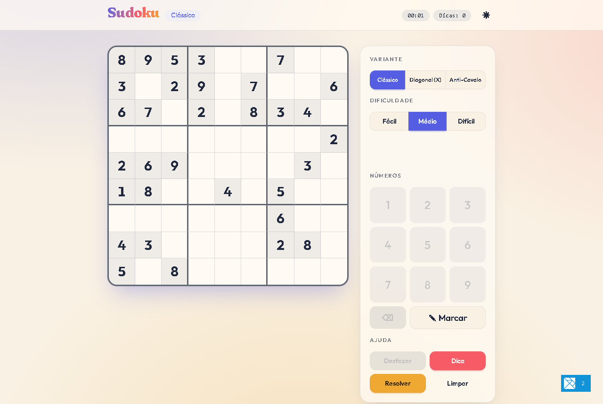
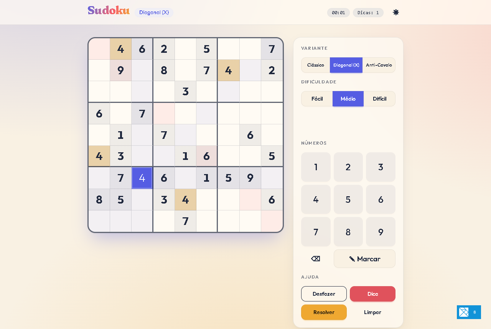

# Sudoku Variantes (Clássico, Diagonal e Anti-Cavalo)

## 1. Identificação

| Nome completo | Matrícula | Turma (14h/16h) | Usuário GitHub |
|---------------|-----------|-----------------|----------------|
| CARLOS HENRIQUE DE SOUZA BISPO | 211061529 | 16h | @carlinn1 |
| ERICK MIRANDA SANTOS | 211061672 | 16h | @Erick-ems |
| FELIPE GUIMARAES FERNANDES | 211041132 | 16h | @felipegf1 |
| GUILHERME COELHO MENDONCA | 202016364 | 16h | @Guilermanoo |
| NICOLLAS GABRIEL OLIVEIRA SOUSA | 211062802 | 16h | @Nicollaxs |
| PAULO HENRIQUE VIRGILIO CERQUEIRA | 211030630 | 16h | @paulocerqr |
| SAMUEL RIBEIRO DA COSTA | 211031486 | 16h | @SamuelRicosta |

- **Nome do projeto:** Sudoku Variantes (Clássico, Diagonal e Anti-Cavalo)
- **Nome do grupo:** LogicGrid 16h
- **Repositório:** https://github.com/carlinn1/paradigmas-trabalho-final
- **Commit ou tag entregue:** `v1.0`
- **Ponto de partida:** variante do Sudoku
- **Slides da apresentação oral:** não há

## 2. Resumo

Aplicação web de Sudoku com suporte a três conjuntos de regras selecionáveis em tempo real: **Clássico**, **Diagonal (X-Sudoku)** e **Anti-Cavalo (Anti-Knight)**. O motor em **Prolog** (`CLP(FD)`) descreve declarativamente as restrições de cada variante, gera tabuleiros aleatórios com solução única garantida, calcula dicas pela casa mais restrita (heurística *first-fail*) e resolve qualquer estado válido. O frontend em **Elm** gerencia o tabuleiro imutável, o destaque instantâneo de conflitos por variante, marcações de candidatos, histórico de desfazer (`Undo`) e cronômetro.





## 3. Como executar

**Requisitos:**

- SWI-Prolog 9.2 ou superior (testado na versão 10.0.2, com `swipl` no `PATH`)
- Node.js 20 ou superior, com `npm`
- `uv` (gerenciador Python 3.12+)

**Instalação e execução:**

```sh
make install
make dev
```

Após subir os servidores, acesse `http://localhost:5173`. A documentação da API fica em `http://localhost:8000/docs`.

**Testes:**

```sh
swipl -g run_tests -t halt backend/prolog/test_sudoku.pl
cd backend && uv run pytest
cd frontend && npm test
cd frontend && npx elm-format --validate src tests
uv run scripts/validar_entrega.py RELATORIO.md
```

**Testado em:** Windows 11 (frontend Vite/Elm e Edge) + Ubuntu/WSL2 (SWI-Prolog 10.0.2 e FastAPI/Janus).

## 4. Arquitetura

```
[Navegador: Elm + Vite] --HTTP/JSON--> [FastAPI: Python] --janus--> [SWI-Prolog: CLP(FD)]
```

| Parte | Responsabilidade | Arquivos principais |
|---|---|---|
| Prolog | Restrições CLP(FD) das variantes, geração com solução única, resolução e dica MRV | `backend/prolog/sudoku.pl`, `backend/prolog/test_sudoku.pl` |
| Elm | Estado imutável, tipos algébricos, validação instantânea de conflitos por variante, interface e cronômetro | `frontend/src/Sudoku.elm`, `frontend/src/Types.elm`, `frontend/src/Main.elm`, `frontend/src/View.elm`, `frontend/src/Api.elm` |
| Python | Apenas ponte HTTP/JSON com validação Pydantic e chamadas via `janus-swi` | `backend/app/main.py`, `backend/app/prolog.py` |

## 5. Parte em Prolog

### 5.1 Predicados principais

| Predicado | Local | O que faz |
|---|---|---|
| `sudoku_constraints(+Variant, ?Rows)` | `backend/prolog/sudoku.pl:83` | Aplica domínio `1..9`, `all_distinct` em linhas/colunas/blocos e as restrições extras da variante |
| `variant_constraints(+Variant, ?Rows)` | `backend/prolog/sudoku.pl:98` | Impõe `all_distinct` nas duas diagonais (`diagonal`) ou `#\=` em saltos de cavalo (`anti_knight`) |
| `solve(+Variant, +Puzzle, -Solution)` | `backend/prolog/sudoku.pl:197` | Converte `0` em variáveis livres e resolve com `labeling([ff], Cells)` |
| `count_solutions(+Variant, +Puzzle, +Limit, -Count)` | `backend/prolog/sudoku.pl:212` | Conta soluções até `Limit` usando `limit/2` e `findall/3` para provar unicidade |
| `generate(+Variant, +Difficulty, -Puzzle)` | `backend/prolog/sudoku.pl:257` | Gera grade completa aleatória e remove pistas mantendo `unique_solution/2` |
| `hint(+Variant, +Board, -Result)` | `backend/prolog/sudoku.pl:350` | Seleciona a casa vazia mais restrita via `fd_size/2` (`best_hint_cell/4`) e retorna `[Row, Col, Value]` |

### 5.2 Conceitos do paradigma lógico utilizados

- [x] Fatos e regras como base de conhecimento: `difficulty_clues/2` (`backend/prolog/sudoku.pl:249`) e `knight_offsets/1` (`backend/prolog/sudoku.pl:132`).
- [x] Unificação e casamento de padrões: extração das 9 linhas em `sudoku_constraints/2` (`backend/prolog/sudoku.pl:92`) e decomposição de listas em `blocks/3` (`backend/prolog/sudoku.pl:151`).
- [x] Recursão (inclusive sobre listas): `main_diagonal/3`, `anti_diagonal/3`, `knight_constraints/3`, `apply_knight_offsets/5` e `dig_holes/5`.
- [x] Backtracking e múltiplas soluções: enumeração aleatória em `random_labeling/1` (`backend/prolog/sudoku.pl:282`) e contagem em `count_solutions/4`.
- [x] `findall/3`, `bagof/3`, `setof/3` ou similares: `findall/3` em `count_solutions/4`, `empty_positions/2` e `best_hint_cell/4`.
- [x] Corte (`!`) ou negação (`\+`), e por que foram necessários: corte em `cell_var/2` (`backend/prolog/sudoku.pl:183`) para não reverter `0` após criar variável livre, e em `solve/3` e `generate/3` para garantir determinismo.
- [x] Programação por restrições (CLP(FD) ou outra): `ins`, `all_distinct/1`, `transpose/2`, `#\=` e `fd_size/2` da `library(clpfd)`.
- [x] Predicados de ordem superior (`maplist`, `foldl`, `include` etc.): `maplist/2`, `maplist/3` e `include/3` em `grid_vars/2` e `clue_count/2`.

### 5.3 Trecho em destaque

Trecho de `backend/prolog/sudoku.pl:83-105` que define as restrições das variantes:

```prolog
sudoku_constraints(Variant, Rows) :-
    must_be(oneof([classic, diagonal, anti_knight]), Variant),
    length(Rows, 9),
    maplist(same_length(Rows), Rows),
    append(Rows, Cells),
    Cells ins 1..9,
    maplist(all_distinct, Rows),
    transpose(Rows, Columns),
    maplist(all_distinct, Columns),
    Rows = [R1, R2, R3, R4, R5, R6, R7, R8, R9],
    blocks(R1, R2, R3),
    blocks(R4, R5, R6),
    blocks(R7, R8, R9),
    variant_constraints(Variant, Rows).

variant_constraints(classic, _Rows).
variant_constraints(diagonal, Rows) :-
    main_diagonal(Rows, 0, MainDiag),
    anti_diagonal(Rows, 8, AntiDiag),
    all_distinct(MainDiag),
    all_distinct(AntiDiag).
variant_constraints(anti_knight, Rows) :-
    knight_constraints(Rows, Rows, 0).
```

O código apenas declara as propriedades que uma solução válida deve satisfazer (`all_distinct` nas linhas, colunas, blocos e diagonais, ou desigualdade `#\=` para saltos de cavalo), sem implementar laços de busca manuais. A biblioteca `CLP(FD)` propaga reduções de domínio automaticamente e o `labeling([ff], Cells)` escolhe sempre a variável com menor domínio restante. Na variante `anti_knight`, evitamos `forall/2` ao registrar `#\=` porque o `forall/2` desfaz bindings por backtracking, usando recursão explícita sobre os deslocamentos em `apply_knight_offsets/5` (`backend/prolog/sudoku.pl:134`).

## 6. Parte em Elm

### 6.1 Modelo e mensagens

Os tipos centrais vivem em `frontend/src/Types.elm:34-76` e `frontend/src/Sudoku.elm:53-79`:

```elm
type Variant
    = Classic
    | Diagonal
    | AntiKnight

type Status
    = Loading
    | Ready
    | Failed String

type alias Model =
    { board : Board
    , history : List Board
    , selected : Maybe Position
    , variant : Variant
    , difficulty : Difficulty
    , mode : InputMode
    , darkTheme : Bool
    , status : Status
    , elapsedSeconds : Int
    , hintsUsed : Int
    }
```

Substituímos o par `loading : Bool` e `error : Maybe String` pelo tipo soma `Status`, impedindo estados inconsistentes como exibir erro e carregamento simultâneos. O histórico de jogadas `history : List Board` aproveita a imutabilidade para implementar o `Undo` sem cópias mutáveis, e `Variant` garante verificação exaustiva pelo compilador em todo `case`.

### 6.2 Conceitos do paradigma funcional utilizados

- [x] Arquitetura Elm (Model, update, view): separação entre `Types.elm`, `Main.elm` (`init`, `update`, `subscriptions`) e `View.elm` (`view`).
- [x] Custom types e `case` exaustivo: `Variant`, `Cell`, `Status`, `InputMode`, `Difficulty` e `Msg`.
- [x] `Maybe` e `Result` no lugar de null e exceções: `selected : Maybe Position`, `valueOf : Cell -> Maybe Int` e respostas HTTP como `Result String a`.
- [x] Funções de ordem superior e aplicação parcial: `List.filterMap`, `List.any`, `Array.indexedMap` e `applyBoardChange` (`frontend/src/Main.elm:211`).
- [x] Composição (`|>`, `>>`): pipelines em `Sudoku.fromLists`, `Sudoku.toLists` e `placeNumber`.
- [x] Decoders e encoders JSON: `boardDecoder`, `hintDecoder`, `encodeBoardRequest` e `keyDecoder` (`frontend/src/Api.elm`, `frontend/src/Main.elm:239`).
- [x] Comandos e subscriptions (efeitos controlados): `Cmd Msg` em `Api.elm` e `Sub.batch` com `Browser.Events.onKeyDown` e `Time.every 1000 Tick` (`frontend/src/Main.elm:232`).
- [x] Imutabilidade e atualização de records: atualização funcional de `Model` em `Main.update` e pilha imutável `history`.

### 6.3 Trecho em destaque

Trecho de `frontend/src/Sudoku.elm:276-295`:

```elm
peers : Variant -> Position -> Position -> Bool
peers variant (( r1, c1 ) as p1) (( r2, c2 ) as p2) =
    let
        classicPeer =
            r1 == r2 || c1 == c2 || sameBox p1 p2

        variantPeer =
            case variant of
                Classic ->
                    False

                Diagonal ->
                    (r1 == c1 && r2 == c2) || (r1 + c1 == 8 && r2 + c2 == 8)

                AntiKnight ->
                    sameKnightMove p1 p2
    in
    p1 /= p2 && (classicPeer || variantPeer)
```

Uma única função pura `peers` parametriza tanto o destaque visual de casas relacionadas e a limpeza automática de candidatos (`removeMarkFromPeers`) quanto a detecção instantânea de conflitos (`conflicts`), mantendo a regra de vizinhança desacoplada de HTML e HTTP.

## 7. Integração

| Rota / chamada | Entrada | Saída | Predicado Prolog |
|---|---|---|---|
| `POST /api/generate` | `{"variant": "classic\|diagonal\|anti_knight", "difficulty": "easy\|medium\|hard"}` | `{"board": [[int]]}` | `sudoku:generate/3` |
| `POST /api/solve` | `{"variant": "...", "board": [[int]]}` | `{"board": [[int]]}` ou 422 | `sudoku:solve/3` |
| `POST /api/hint` | `{"variant": "...", "board": [[int]]}` | `{"row": int, "col": int, "value": int}` ou 422 | `sudoku:hint/3` |

## 8. Testes e validação

- **Prolog (`plunit`):** 19 testes em `backend/prolog/test_sudoku.pl` cobrindo resolução, contagem de soluções, geração com solução única, dicas e restrições das variantes `diagonal` e `anti_knight`, além de validação de argumentos inválidos; zero avisos ao carregar `sudoku.pl` no `swipl`.
- **Backend (`pytest`):** 10 testes em `backend/tests/test_api.py` cobrindo todas as rotas, variantes e erros 422 com `TestClient` e `janus-swi`.
- **Frontend (`elm-test` + `elm-format`):** 10 testes unitários em `frontend/tests/SudokuTest.elm` cobrindo `peers`, `conflicts`, `setCell`, `toggleMark`, `removeMarkFromPeers` e `clearGuesses` nas três variantes, além de `elm-format --validate` e build de produção com `vite build`.
- **Casos de borda verificados:** célula central `(4,4)` pertencente às duas diagonais no modo `Diagonal`; saltos de cavalo em blocos 3x3 distintos no modo `AntiKnight`; histórico de `Undo` ignorando operações sem efeito (`pushHistory`); tabuleiro completo ou sem solução retornando HTTP 422 tratado em `Api.elm`.

## 9. Limitações e problemas conhecidos

- A geração em modo `hard` com remoção gulosa de pistas nem sempre atinge o mínimo teórico de 17 pistas, mantendo ~26 pistas por ser mais rápida e estável.
- O cronômetro é pausado apenas quando o tabuleiro fica completo ou durante carregamento, não possuindo botão manual de pausa nem persistência em `localStorage`.
- No Windows, é necessário ter o `swipl` instalado e acessível no `PATH` e no Registro para que o `janus-swi` localize a `libswipl.dll`.
- Com mais tempo, o grupo adicionaria um explicador textual passo a passo das técnicas lógicas usadas pela dica e mais uma variante (como Killer Sudoku).

## 10. Contribuição de cada integrante

| Integrante | Principais contribuições |
|---|---|
| CARLOS HENRIQUE DE SOUZA BISPO | Arquitetura geral, variantes CLP(FD) em Prolog, integração FastAPI/Janus, revisão do frontend Elm e relatório |
| ERICK MIRANDA SANTOS | Testes unitários em Prolog (`plunit`) e validação das restrições `diagonal` e `anti_knight` |
| FELIPE GUIMARAES FERNANDES | Refatoração de tipos em `Types.elm`, `Undo` e cronômetro no `Main.elm` |
| GUILHERME COELHO MENDONCA | Extração de `View.elm`, destaque visual das diagonais e ajustes responsivos em `style.css` |
| NICOLLAS GABRIEL OLIVEIRA SOUSA | Suíte de testes em Elm (`SudokuTest.elm`) e testes de API (`test_api.py`) |
| PAULO HENRIQUE VIRGILIO CERQUEIRA | Redação técnica das seções de Prolog/Elm no `RELATORIO.md` e revisão com `validar_entrega.py` |
| SAMUEL RIBEIRO DA COSTA | Testes manuais ponta a ponta no navegador, capturas de tela e roteiro da apresentação oral |

## 11. Fontes, código de terceiros e uso de IA

**Código reaproveitado.** Partimos do template oficial do professor (`fabiommendes/paradigmas-trabalho-final`), mantendo a estrutura FastAPI/Janus (`backend/app/main.py` e `backend/app/prolog.py`), o arquivo de estilos base (`frontend/src/style.css`) e os predicados base de `sudoku.pl`, evoluindo o projeto para suportar as variantes `diagonal` e `anti_knight`, dica por menor domínio (`best_hint_cell/4`), separação modular em Elm (`Types.elm` e `View.elm`), `Undo`, cronômetro e testes unitários em Elm (`SudokuTest.elm`).

**Referências.** Documentação oficial do SWI-Prolog (`library(clpfd)`, `library(plunit)` e `janus-swi`), guia oficial da linguagem Elm e documentação do daisyUI 5 / Tailwind CSS v4.

**Uso de ferramentas de IA.**

- **Faixa de uso no código:** intensivo

| Ferramenta | Para que foi usada | Como o grupo verificou o resultado |
|---|---|---|
| Antigravity (assistente de código com IA) | Implementação das variantes em Prolog e Elm, extração de `Types.elm`/`View.elm`, criação de `SudokuTest.elm` e apoio na redação do relatório | Execução completa das suítes `plunit` (19 testes), `pytest` (10 testes), `elm-test` (10 testes), `elm-format --validate`, `vite build`, teste ponta a ponta no navegador Edge e `validar_entrega.py` |

## 12. Apresentação oral

- **Slides:** não há
- **Roteiro:**

| Parte | Duração | Quem apresenta |
|---|---|---|
| Contexto e variantes escolhidas | 2 min | CARLOS HENRIQUE DE SOUZA BISPO |
| Demonstração ao vivo (Clássico, Diagonal, Anti-Cavalo) | 4 min | SAMUEL RIBEIRO DA COSTA |
| Código Prolog (CLP(FD) das variantes e dica MRV) | 4 min | ERICK MIRANDA SANTOS, NICOLLAS GABRIEL OLIVEIRA SOUSA |
| Código Elm (tipos fortes, `peers`, `View.elm` e `Undo`) | 3 min | FELIPE GUIMARAES FERNANDES, GUILHERME COELHO MENDONCA |
| Testes, limitações e aprendizados | 2 min | PAULO HENRIQUE VIRGILIO CERQUEIRA |

## 13. Reflexão sobre os paradigmas

Em Prolog, adicionar duas variantes inteiras de Sudoku exigiu apenas declarar novas restrições (`all_distinct` nas diagonais e `#\=` nos saltos de cavalo), sem alterar o mecanismo de busca. Em uma linguagem imperativa, seria necessário reescrever loops de verificação e poda em vários pontos do resolvedor. Por outro lado, o paradigma lógico exige atenção constante a efeitos de backtracking, como a escolha de recursão explícita em vez de `forall/2` para que as restrições `CLP(FD)` permaneçam registradas.

Em Elm, o compilador funcionou como um guia seguro durante toda a evolução do modelo: ao introduzir `Variant` e substituir pares soltos de booleanos por `Status`, cada `case` incompleto na interface e na camada de API foi apontado imediatamente em tempo de compilação. A separação estrita entre domínio puro (`Sudoku.elm`), efeitos (`Api.elm`) e visualização (`View.elm`) mostrou como o controle de efeitos e a imutabilidade tornam funcionalidades como o `Undo` triviais e confiáveis.
